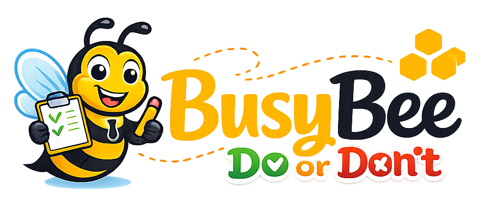

# Busy bee

Busy bee(do or don't) is a modern task management application built to help teams and individuals organize projects, track progress, and manage daily workflows in a clean and intuitive interface.

The application allows users to create boards, organize tasks into lists, and manage project activities efficiently. It is designed for productivity, collaboration, and easy project tracking.

### Technologies Used
- React
- TypeScript
- JavaScript
- Tailwind CSS
- Daisy UI
- Firebase
- Context API
- Vite
- npm

### 2. Setup & Start

**1. Clone the Repository**

**Bash**
```
git clone https://github.com/desi-petrova/do-or-dont.git
cd .\busy-bee\
npm install
```

**2. Create Firebase Project**

* Go to [Firebase Console](https://console.firebase.google.com/?utm_source=chatgpt.com)
* Create a new project
* Enable:
    - Realtime Database
    - Authentication with email and password
* Create a Web App inside Firebase
* Copy your Firebase configuration


**3. Firebase Configuration**
* Go to folder ```busy-bee/src/config/```
* Create file ```firebaseConfig.ts``` 

You can use the provided template file and replace the values with your Firebase project configuration.

Example:
```
import { initializeApp } from "firebase/app";
import { getAuth } from "firebase/auth";
import { getDatabase } from "firebase/database";

const firebaseConfig = {
  apiKey: "YOUR_API_KEY",
  authDomain: "YOUR_AUTH_DOMAIN",
  projectId: "YOUR_PROJECT_ID",
  storageBucket: "YOUR_STORAGE_BUCKET",
  messagingSenderId: "YOUR_MESSAGING_SENDER_ID",
  appId: "YOUR_APP_ID",
};

const app = initializeApp(firebaseConfig);
export const auth = getAuth(app);
export const db = getDatabase(app);
```

**4. Start Development Server**
* Open Terminal or Bash:
```
npm run dev
```

* The application will run locally on:
```
http://localhost:5173
```

### 3. Database Information
This project is currently configured to work with Firebase.

All service files and database logic are created for:
* Firebase Authentication
* Firebase Realtime Database

You can use another database or backend service if needed, but additional configuration and service updates will be required.

### 4. Current Functionalities
**1. Authentication System**

The application includes a complete authentication flow powered by Firebase Authentication.

Users can:
* Create a new account using email and password
* Log in securely to their personal workspace
* Stay authenticated between sessions
* Access protected routes available only for authenticated users
* Log out safely at any time

Authentication is handled with secure Firebase services and integrated directly into the frontend application.

**2. Board Management**

Users can create and manage multiple boards for different projects, workflows, or personal tasks.

Current board functionalities include:
* Create new boards
* Save boards to Firebase Realtime Database
* Display all user boards inside the sidebar
* Quick navigation between boards
* Organized workspace structure for better project management
* Board owners can add members by searching users by name, handle, or email
* View board member names and avatars in the sidebar
* Remove board members; removing a member also removes them from cards on that board

Each board acts as an independent workspace where users can organize tasks and track progress.

**3. Task Organization System**

Every board contains a task management structure divided into default workflow columns:
* To Do
* In Progress
* Done

This structure helps users manage task progress clearly and efficiently.

Users can:
* Add new task cards
* Create additional custom lists
* Organize tasks by workflow stage
* Visually separate completed and active tasks
* Manage multiple tasks inside different boards
* Assign card members from the board's existing members
* View assigned member avatars on each card
* Remove members from individual cards
* Edit a card's name inline
* Add a description, then click its displayed text to edit it
* Add or remove colored labels: Urgent, Pending, In Progress, Needs Review, Blocked, Complete, and Low Priority; labels appear as named badges in card details and as color markers on the board

The current system provides a simple and clean workflow management experience that can easily scale with future features.

**4. Sidebar Navigation**

The sidebar provides fast and intuitive navigation across the application.

Features include:
* Display all created boards
* Quick access to selected boards
* Clean workspace navigation
* Improved user experience for managing multiple projects

The sidebar updates dynamically based on user-created content stored in the database.

**5. Realtime Database Integration**

The application uses Firebase Realtime Database for storing and managing application data.

Current integration includes:
* Saving user authentication data
* Storing boards and task lists
* Persisting task cards
* Persisting board members, card assignments, labels, card names, and descriptions
* Synchronizing user content with the database through live listeners
* Fast and scalable cloud-based storage

Live listeners keep board and card data synchronized with changes in the database.

**6. Responsive User Interface**

The interface is designed with usability and clean design principles in mind.

Current UI features include:
* Responsive layouts
* Modern design using Tailwind CSS and Daisy UI
* Reusable React components
* Simple and intuitive navigation
* Organized task presentation
* Consistent spacing and styling across the application

The goal is to provide a smooth and productive experience across different screen sizes and devices.

### 5. Upcoming Features

Planned features for future development:
* Due dates
* File attachments
* Comments system
* Drag & drop functionality
* Activity history
* Notifications
* Dark mode
* Search and filtering
* Responsive mobile improvements

### 6. Note 
This project is under active development and new features will continue to be added.

Contributions, suggestions, and feedback are welcome.
